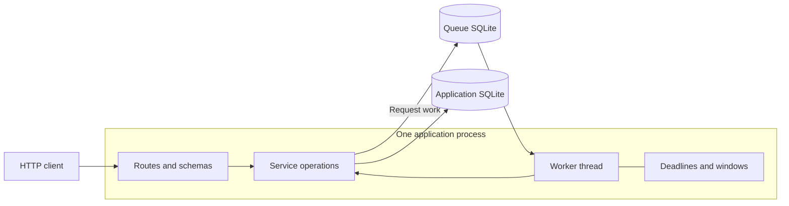
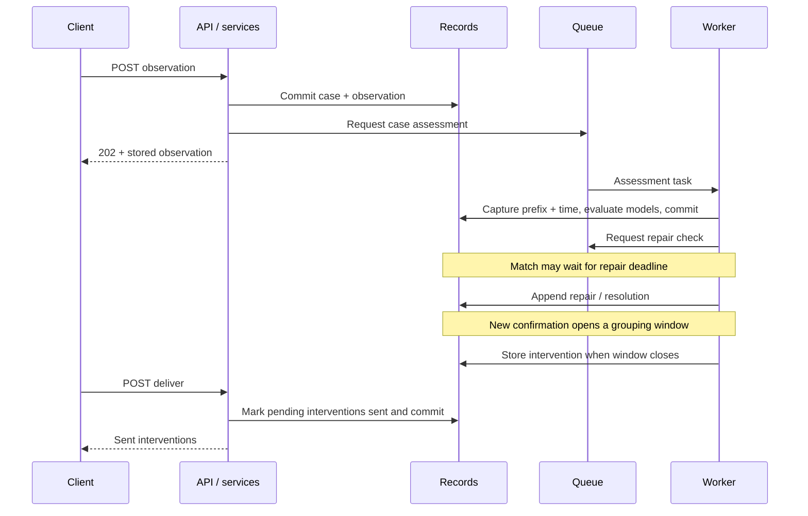
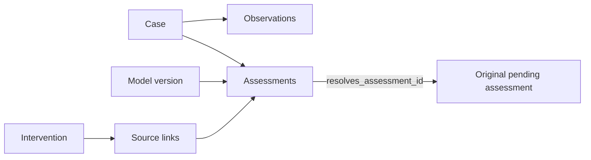

# Developer guide

This guide describes the current implementation.

## 1. Environment and architecture

Install Git and [uv](https://docs.astral.sh/uv/getting-started/installation/), clone the repository, and run from its root:

```bash
uv sync --locked
uv run pre-commit install
uv run fastapi dev src/normative_conformance/main.py
```

`.python-version` pins Python 3.13. `uv.lock` pins dependencies. The development server reloads on changes. Each reload restarts the worker. Use separate storage for experiments, as shown in the [user guide](user_guide.md). Readiness is `GET /health/ready`. The interactive API is `/docs`.



Routes validate input, supply dependencies, and return service results. Services own operations, including transaction boundaries and follow-up work. The scheduler coalesces waiting requests per case. After a task starts, new observations can queue a follow-up. Assessment and repair requests have separate waiting sets. One process owns the worker and its coordination state.

`stage_observation` inserts an observation within a caller-owned write transaction. It does not commit, roll back, or schedule assessment. `ingest` commits the transaction before requesting assessment.

Startup configures logging, migrates storage, validates every stored model, and starts the worker. Model validation checks the schema, rule execution against an empty case, and intervention-message coverage. The worker uses this validated catalog until restart.

## 2. Assessment and intervention flow



The sequence shows successful operation. A **202** confirms observation storage and a successful scheduling request, not assessment completion. If queueing fails after commit, **503 ENQUEUE_FAILED** carries `committed_observation`. A duplicate submission does not retry scheduling.

Cases start without a target. The worker skips unresolved cases. Ingestion recomputes order-based selections from speech start/end time and receipt sequence; missing and `PENDING` labels do not count. Manual selections persist until explicitly replaced. Configuring a resolved target schedules existing speech through the current queue.

Each evaluation captures a case sequence and server time. Rules query that prefix. New arrivals belong to later evaluations. A matching undesired model creates `pending` with a deadline or `conformant` immediately when its allowance is null. No match creates no assessment. Reusing a pending match preserves its original deadline.

Repair timeliness uses server receipt time. A qualifying repair must arrive strictly before the deadline and remove the original match at its speech boundary. Resolution appends a linked `non-conformant` or `conformant` assessment. The original remains unchanged. A recognized repair also permits future detection after that boundary.

New undesired confirmations open one grouping window per case. At window close, one message is selected by an ordered policy table, and the intervention links all eligible unlinked confirmations since the window opened. The window batches work. Slow evaluation can include confirmations after its nominal end. The policy currently always authorizes a message.

## 3. Code and stored data

Paths below are relative to `src/normative_conformance/`.

| Location | Responsibility |
|---|---|
| `main.py`, `lifespan.py`, `config.py` | ASGI app, startup/shutdown, environment settings |
| `routes/`, `schemas/` | HTTP boundary and validated public contracts |
| `static/`, `services/capture/` | Microphone streaming, transcripts, and RMS levels |
| `clients/` | External service adapters; `assemblyai.py` implements the capture `Transcriber` |
| `services/case/` | Configure case targets and resolve distinct speaker order |
| `services/observation/` | Store and retrieve observations; stage inserts within caller-owned transactions |
| `services/model/`, `services/assessment/` | Evaluate SQL models and append results |
| `services/scheduler/` | Request coalescing, worker loop, repair and intervention timers |
| `services/intervention/`, `services/health/` | Create/deliver messages. Check readiness |
| `models/`, `database.py`, `queue.py` | SQLModel tables, transactions, persistent task queue |
| `migrations/` | Alembic environment and schema/catalog revisions |
| `logging.py`, `timestamps.py` | Structured diagnostics and UTC/microsecond conversion |



An assessment records its model version and evaluated prefix (`through_sequence`). The API reconstructs that prefix as `extent`. It is the evaluated history, not a minimal set of causal observations. Rule explanations record status and any repair observation IDs. SQLModel tables and database triggers enforce the stored invariants. Times are integer UTC microseconds in storage and timezone-aware timestamps at API boundaries.

## Microphone capture and tests

The page scripts are ES modules under `static/`:

| File | Responsibility |
|---|---|
| `capture.js` | Binds buttons, readouts, and the transcript view |
| `capture/session.js` | `CaptureSession` creates a case with the selected speaker order, owns the microphone, audio graph, and WebSocket, and releases resources once. It reports status keys, not text |
| `capture/status.js` | Fixed page text for each status key |
| `capture/levels.js` | Summarizes one `levels` message |
| `capture/transcript.js` | Groups word labels and updates transcript rows by turn order |
| `pcm-worklet.js` | Converts audio to 100 ms PCM16 packets |

The capture page uses an [AudioWorklet](https://developer.mozilla.org/en-US/docs/Web/API/AudioWorkletProcessor) in a 16 kHz audio context to emit mono PCM16. The worklet leaves its output silent to avoid microphone playback. It flushes its final packet before sending the stop command. Browser and server buffers are bounded; a browser send backlog above one second stops capture with a gap message.

After microphone access succeeds, the page uses `PUT /api/v1/cases/{case_id}/target` to create a case with a fresh UUID and the selected speaking order. It passes that ID in the capture WebSocket's `case_id` query parameter. Setup failures release microphone resources and allow another Start.

`routes/capture.py` verifies the case in a short read session before accepting the browser WebSocket. It reads binary PCM and the `stop` text, sends JSON messages, and maps failures to fixed error text and close codes. `services/capture/run_capture.py` contains the capture logic and does not see the socket. It receives the case ID, server clock, browser messages as an async iterator, and send/store functions. It measures levels, buffers and forwards audio, stores finalized speech before sending it to the page, and waits for the transcriber to finish on Stop.

`services/capture/run_capture.py` retains signal frames and tracks finalized words after storage succeeds. The pure `build_observations` function in `services/capture/observations.py` groups consecutive word labels, builds stable observation IDs and UTC speech times, and summarizes overlapping frames. `services/capture/store_observations.py` uses `stage_observation` in a short write transaction per turn and schedules assessment after commit when a target is resolved. The route runs storage in a thread pool, so database work does not block the event loop. No database session is held while waiting for provider events. Speaker revisions affect the live view only; stored observations remain append-only.

`LevelMeter` carries incomplete 20 ms frames between messages and discards audio after measurement. `PCMBuffer` keeps a short audio tail so the final provider packet meets the 50 ms minimum without modifying samples.

`services/capture/transcriber.py` defines the `Transcriber` interface and the transcript events capture consumes: turn updates, speaker revisions, and speech start. `clients/assemblyai.py` implements it over `websockets`. It holds the stream settings, validates the provider event fields it consumes, ignores the rest, converts unattributed speaker labels to None, and terminates the session on exit unless Stop already did. Unknown or malformed provider events end capture with a protocol error. Provider exceptions become fixed error codes without exposing credentials or response bodies. `schemas/capture.py` types the outgoing browser messages.

Python unit tests cover level math, packet boundaries, capture orchestration with a fake transcriber, AssemblyAI event conversion with a connection double, and route transport with a socket double. Integration tests exercise both WebSocket connections against a local provider server, including final revisions and early disconnects. JavaScript unit tests use Node's built-in test runner and browser API doubles; they do not establish microphone or browser compatibility. Run them with the Node version pinned in `.nvmrc`:

```bash
nvm use
node --test "tests/unit/static/**/test_*.mjs"
```

For a browser check, open `/capture` on localhost, grant microphone access, speak, stop, and confirm the microphone indicator switches off. Repeat after denying permission and after interrupting the connection. Run the Python checks listed in [Useful commands](commands.md).
