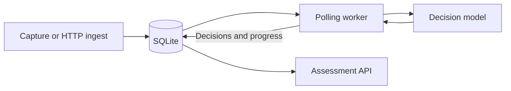

# Developer guide

Use the pinned Python and Node versions, `uv sync --locked`, and the [development commands](commands.md). Startup requires a decision-model credential; [deployment](deployment_guide.md) lists settings.

## Assessment flow

One worker visits each ready case per pass, then waits 0.1 seconds. A resolved target and new ingested sequences or a changed target revision make a case ready; it is skipped while its batch is open. Calls are synchronous, so inference delays other cases.

`process_case` loads ingested speech and the target in a read transaction. `batch_end` ends a batch at the target's last observation once another speaker's observation arrives, or earlier when its speech spans `DECISION_MAX_BATCH_SECONDS` or nothing has arrived for `DECISION_IDLE_SECONDS`. `build_snapshot` adds speech ending within `DECISION_CONTEXT_SECONDS` before the batch as context. Decisions use the speaker labels speech arrived with; revisions are not read.

Inference runs outside database transactions. On success, decisions and progress commit together. A target change during inference preserves the decision under its original assignment and leaves the new target pending. Failures leave progress unchanged and retry on later polls. There is no persisted attempt budget or interrupted-request recovery.

## Questions and results

The decision-model adapter calls a pinned model version through the provider SDK with a 30-second HTTP timeout and no SDK retries. `services/decision/` contains batching, context, question construction, answer conversion, and prompt wording. The adapter trusts typed SDK responses.

Every new observation gets topic scores and a primary-topic choice. Only target speech gets the seven behavior scores and hostility intensity. When the batch has new target speech, one action question considers the surrounding conversation, including apologies and clarification. Other batches get no action question.

`store_assessment` retains raw answers in relational tables and the request as JSON. `report_observation` selects scores at the assessment's stored threshold (0.7), sorts labels, and reports an unselected primary topic as `unknown`. Actions are recommendations; there is no automatic intervention creation.

## Storage and capture

See the [schema](schema.md). Times are UTC microseconds in storage and aware timestamps in responses. Append-only triggers protect observations, revisions, target assignments, assessments, and classifications.

Ingested observations have a sequence and receipt time. Corrected observations reference a speaker revision; `replaced_observation` links it to the ingested rows it replaces. Classifications reference exact observation keys. Revisions are records only; decisions, target selection, and polling ignore them.

`target_assignment` records speaker-label changes. Speaking order uses ingested speech; selecting a label clears that order. Assessments reference the assignment they used. Each stored intervention references one `intervene` assessment. Delivery marks it sent once, only while its target revision remains current.

Capture stores each final turn and revision batch before notifying the browser. Finals and corrections share `build_observations`; IDs include session, turn, word span, and label. Storage runs in a thread pool. `LevelMeter` measures 20 ms frames; `PCMBuffer` preserves the provider's minimum packet size. The [API reference](api.md#live-capture-stream) defines the wire protocol.

## Tests

Follow [AGENTS.md](../AGENTS.md): explicit scenario data, isolated unit tests, integration tests for real storage and transport, and at least 95% unit-only branch coverage. Provider doubles test application behavior, not model accuracy. JavaScript tests use browser doubles; check microphone access and Stop separately in a browser.
