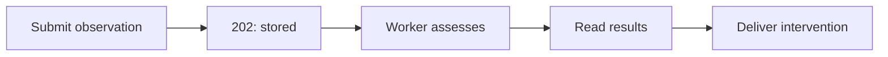
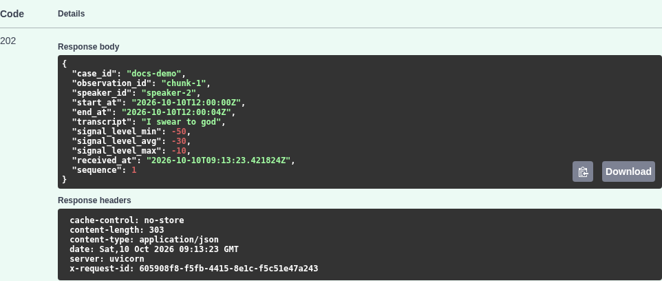
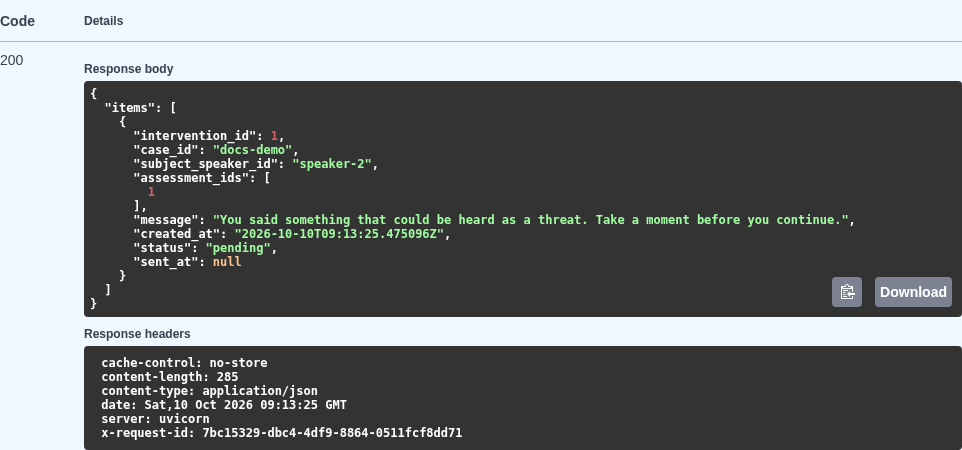

# User guide

For researchers transcribing live speech and replaying synthetic or recorded observations.

## 1. Set up and submit an observation

Install Git and [uv](https://docs.astral.sh/uv/getting-started/installation/), clone the repository, and open a shell in its root. uv installs the pinned Python 3.13. For a separate walkthrough database, run:

```bash
uv sync --locked
export APP_DB_PATH=data/walkthrough/app.sqlite3
export ASSESSMENT_QUEUE_PATH=data/walkthrough/queue
export LOG_DIR=data/walkthrough/logs
uv run fastapi dev src/normative_conformance/main.py
```

Use an unused storage directory for a new run. Keep this terminal open. Startup creates the storage and models automatically. Open [readiness](http://127.0.0.1:8000/health/ready). `{"status":"ready"}` means the database, queue, and worker are available. Open [API docs](http://127.0.0.1:8000/docs).



First execute **PUT /api/v1/cases/{case_id}/target** with `case_id` set to `docs-demo` and body `{"target_speaker_id":"speaker-2"}`. Expect **200**. This creates the case and explicitly selects the known replay label.

Expand **POST /api/v1/observations**, select **Try it out**, replace the request body with the JSON below, and select **Execute**. This synthetic phrase deliberately matches `harm_phrase`. The four-second duration and low signal levels avoid a loud-and-fast match.

```json
{
  "case_id": "docs-demo",
  "observation_id": "chunk-1",
  "speaker_id": "speaker-2",
  "start_at": "2026-10-10T12:00:00Z",
  "end_at": "2026-10-10T12:00:04Z",
  "transcript": "I swear to",
  "signal_level_min": -50,
  "signal_level_avg": -30,
  "signal_level_max": -10
}
```

Expect **202**, the submitted fields, `sequence: 1`, and equal server UTC timestamps for `received_at` and `updated_at`. Each observation ID must be unique within its case. For another run, use a new case ID or a new storage directory. Submitting this record twice gives **409**. The [API reference](api.md#observation-input) explains validation.

## 2. Inspect the stored results

An accepted observation is stored before assessment begins. In `/docs`, execute **GET /api/v1/cases/{case_id}/observations** with `case_id` set to `docs-demo`. It returns the submitted observation inside `items`.



*Actual response from the walkthrough. Server timestamps vary. Screenshots use port 8765 to keep the verification instance separate from normal development.*

Next execute **GET /api/v1/cases/{case_id}/assessments** with the same case ID. Refresh until `items` contains the `harm_phrase` assessment with `status: "conformant"`. There is no repair delay for this model. A successful request can initially return an empty list while the worker is catching up.

| Status | Meaning |
|---|---|
| `pending` | A model matched. Its repair period is still open |
| `conformant` | The observations match the named model. An undesired model can cause an intervention |
| `non-conformant` | A previously pending undesired match was repaired |
| `conflicted` | Reserved in the API. The current evaluator does not produce it |

**Conformant means a model match, not good behavior.** Repair models can also have conformant assessments. Read `model_id` and inspect that model with **GET /api/v1/models/{model_id}/versions/{version}**. `extent` identifies the evaluated case history. A resolution adds a new assessment whose `resolves_assessment_id` points to the original pending record.

For timing experiments, use the supplied replay cases:

```bash
uv run python scripts/send_observations.py scripts/cases/case-3.jsonl --target-speaker-id speaker-2
```

This preserves recorded gaps. [The case manifest](../scripts/manifest.md) describes inputs and expected results. A fixed `--delay` changes receipt timing and can change whether a repair is timely. Keep each experiment's storage separate.

## 3. Read and deliver an intervention

Execute **GET /api/v1/interventions** with `case_id=docs-demo` and `status=pending`. Repeat until the item appears, normally after the two-second grouping window. Reading does not change its state.



Execute **POST /api/v1/cases/{case_id}/interventions/deliver** with `case_id` set to `docs-demo` and no body. The returned item has `status: "sent"` and a `sent_at` timestamp. A second delivery returns `{"items":[]}` when nothing else is pending for the case. Other cases' interventions stay pending. To inspect without consuming, continue using GET. The API does not send audio, email, or another external notification.

### Troubleshooting

| Symptom | Action |
|---|---|
| Cannot connect | Keep the server terminal open. Confirm its host and port |
| 409 on submission | The case/observation pair exists. Inspect it or choose a new identity |
| 422 on submission | Check the response's `detail`. Supply timezone-aware times, end after start, and ordered signal levels |
| Empty results | Check readiness, target speaker, and model match. Allow assessment and repair/window delays |
| 503 | Follow the error-specific action in the [API reference](api.md#errors). Check [known issues](known_issues.md) |

**How do I change the target?** Use `PUT /api/v1/cases/{case_id}/target` with `{"target_speaker_id":"speaker-2"}`. For automatic selection, send `{"target_speaker_order":1}` or `2`. Target selection is stored per case.

## Live microphone transcription

Set `ASSEMBLY_API_KEY` in the server environment or repository `.env`, then start the server. Open [live capture](http://127.0.0.1:8000/capture), choose whether the person to assess will speak **First** or **Second**, then select **Start microphone** and allow microphone access. Have that person speak in the selected order. The page shows the saved case ID, partial and final transcripts, speaker labels, and recent signal levels. The API key stays on the server; audio is sent to AssemblyAI for transcription.

The speaking-order selector is locked during capture. Each Start creates a fresh case with the selected order and no resolved target label. Finalized speech is saved as observations, grouped by consecutive words from the same speaker. The case's target resolves when enough distinct speakers appear in that speech; assessment waits until then. A created case remains stored even if transcription fails to connect.

A turn can contain several speakers. Labels such as **Speaker A** refer only to the current session. **Unassigned** means the provider has not attributed those words; saved observations use `PENDING` for them. Speaker revisions are saved separately and update the existing live transcript, marking the affected turn. They do not change saved observations, target selection, or assessments, and do not trigger reassessment. Original observations and decisions retain the labels available when they were made.

Select **Stop** and wait for the completion message confirming final transcripts and speaker corrections. An error or an early close leaves an incomplete transcript visible; already saved observations remain available. Starting again clears the live display and opens a fresh case and provider session. Reloading clears the display but preserves saved observations. Use **GET /api/v1/cases/{case_id}/observations** in `/docs` with the displayed case ID to inspect them.

The level display shows recent minimum, average, and maximum dBFS plus the duration measured by the server. Silence is −120 dBFS; values near 0 dBFS approach the digital limit. Microphone access requires localhost or HTTPS, AudioWorklet support, and a 16 kHz audio context. Automatic gain control, noise suppression, and echo cancellation are requested off. Capture is rejected if the browser reports any of them enabled; hardware processing can still affect the signal.
